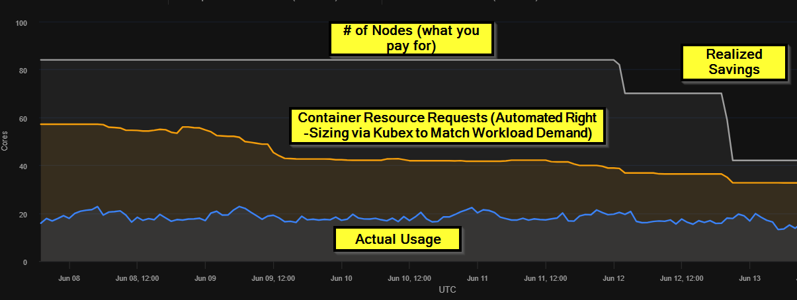
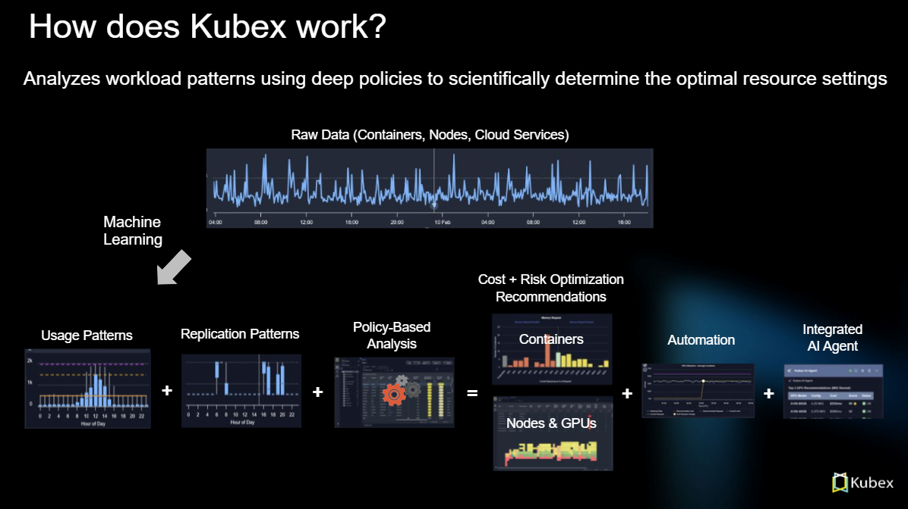
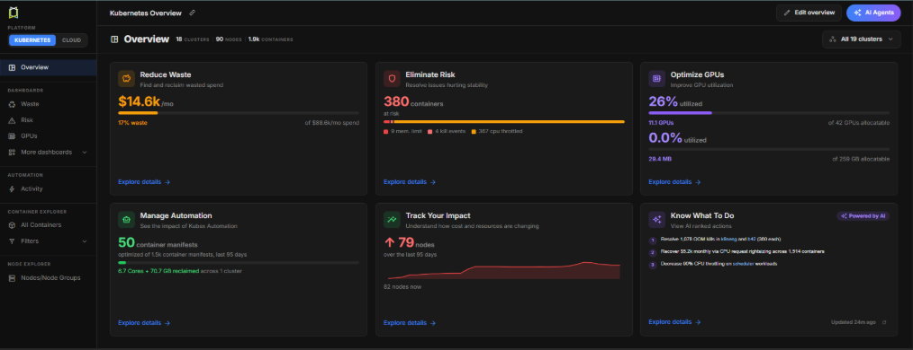

Kubex is an infrastructure optimization platform for Kubernetes and AI environments. It turns telemetry and usage patterns into actionable recommendations for container CPU, memory, GPU, and ephemeral storage resources. It also provides visibility into nodes and node groups, including recommended node families in the Kubex UI, and helps teams apply configured changes through governed automation.

Whether you are evaluating Kubex, connecting your first cluster, or scaling optimization across environments, this page is the best place to start.

<Frame caption="Figure: Value Achieved with Kubex">

</Frame>

## Choose your starting point

Use the path that matches what you need to do next:

- **New to Kubex?** Read [Getting Started with Kubex](/docs-kubex/Content/Kubex/Getting_Started_with_Kubex) to connect a Kubernetes cluster and begin collecting data.
- **Checking compatibility?** Review [Supported Platforms and Integrations](/docs-kubex/Content/General/supported_platforms) before planning your deployment.
- **Looking for savings or risk?** Open [Kubernetes Dashboards](/docs-kubex/Content/Kubex/K8s_Dashboards) to explore waste, health, and automation at a glance.
- **Ready to optimize workloads?** Start with [Container Optimization](/docs-kubex/Content/Kubex/container_optimization), [Node Optimization](/docs-kubex/Content/Kubex/Optimizing_Node_Cost), or [GPU Optimization](/docs-kubex/Content/Kubex/gpu_optimization).
- **Ready to automate?** Read [Automation Engine Overview](/docs-kubex/Content/Kubex/Automation_Engine_Overview) to understand the policy and safety model before deploying automation.

## What Kubex helps you do

Kubex brings discovery, analysis, and action into one workflow:

1. **Collect** Kubernetes and infrastructure telemetry from your connected environments.
2. **Analyze** usage, capacity, cost, and risk to identify the highest-value opportunities.
3. **Recommend** resource and configuration changes based on observed behavior and optimization policies.
4. **Apply** changes through automation that adapts quickly to workload conditions, or update deployment templates through a GitOps workflow.
5. **Review** optimization results through Kubex dashboards and monitor automation status in the cluster.

<Frame caption="Figure: How Kubex works">

</Frame>

## Core capabilities

### Kubernetes optimization

- Right-size container CPU and memory requests and limits based on workload behavior.
- Optimize nodes and node groups to improve utilization, capacity planning, and cost efficiency.
- Identify health and saturation risks before they become performance incidents.
- Explore recommendations through dashboards, analysis tables, filters, and utilization charts.

### AI and GPU infrastructure optimization

Improve utilization of expensive AI infrastructure by considering GPU allocations alongside CPU, memory, storage, scheduling, and workload demand. See [GPU Optimization](/docs-kubex/Content/Kubex/gpu_optimization) for the GPU-specific workflow.

### Governed automation

Use the Kubex Automation Engine to apply container recommendations at scale. Policies define what can change and under which conditions, while safety controls evaluate constraints such as HPA, LimitRange, ResourceQuota, PodDisruptionBudget, workload readiness and node capacity.

Read [Automation Engine Safety and Operations](/docs-kubex/Content/Kubex/Automation_Engine_Safety_and_Operations) before moving from recommendations to automated changes.

### Shared operational context

Kubex gives SRE, platform engineering, FinOps, and application teams a common view of infrastructure decisions. Recommendations include technical context so teams can connect cost and efficiency improvements to reliability and performance goals.

<Frame caption="Figure: K8s Overview Dashboard">

</Frame>

## Common outcomes

### Reduce waste without guessing

Identify overprovisioned workloads and right-size requests and limits to recover unused capacity while preserving application performance.

### Improve reliability and headroom

Use data-driven recommendations to reduce saturation risk, improve headroom planning, and prevent avoidable performance incidents.

### Operate consistently at scale

Standardize optimization across clusters and environments with policies, scheduling windows, safety checks, and auditable automation workflows.

### Connect technical work to business value

Give engineering and FinOps teams a shared view of opportunities, expected impact, and results instead of relying on disconnected reports.

## Who should use Kubex?

- **SRE and platform engineering:** improve cluster efficiency while protecting reliability and operational control.
- **FinOps and cloud operations:** identify measurable savings opportunities with the technical context needed to act on them.
- **Engineering leaders:** establish repeatable optimization practices across teams and environments.
- **AI platform teams:** improve the utilization and planning of GPU-backed workloads.

## Explore the documentation

- [Data Collection Overview](/docs-kubex/Content/Kubex/Data_Collection_Overview) — deploy the collection stack and monitor connected clusters.
- [Kubernetes Dashboards](/docs-kubex/Content/Kubex/K8s_Dashboards) — review usage, waste, risk, and automation summaries.
- [Container Optimization](/docs-kubex/Content/Kubex/container_optimization) — understand workload efficiency and right-sizing recommendations.
- [Node Optimization](/docs-kubex/Content/Kubex/Optimizing_Node_Cost) — improve node and node-group utilization.
- [Automation Engine Overview](/docs-kubex/Content/Kubex/Automation_Engine_Overview) — deploy and operate governed automation.
- [Kubex AI Agent](/docs-kubex/Content/General/KubexAIAgent) — use natural-language questions to find insights and navigate Kubex.

<Note>
  Kubex analyzes data from your connected environments. Start with [Data Collection Overview](/docs-kubex/Content/Kubex/Data_Collection_Overview) to deploy the collection stack, or review [Supported Platforms and Integrations](/docs-kubex/Content/General/supported_platforms) to confirm that your environment is supported.
</Note>
