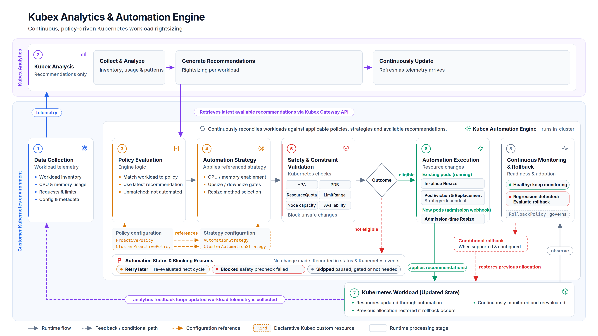
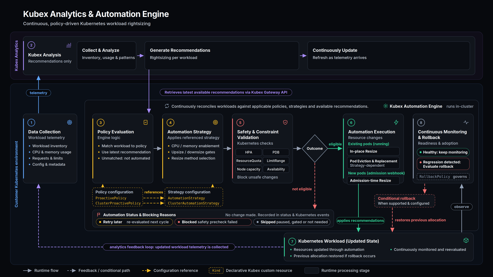

Kubex Automation Engine is the Kubernetes rightsizing automation component that applies Kubex recommendations safely and continuously. It uses policy-driven controls to automatically optimize CPU, memory, ephemeral storage, and GPU resources while preserving workload stability and platform controls.

## How It Works

Automation Engine operates within your Kubernetes cluster and works with Kubex Analytics in a continuous cycle:

1. **Kubex Analytics** analyzes workload utilization and generates rightsizing recommendations
2. **Automation Engine** retrieves recommendations through the Gateway API and evaluates them against your policies
3. **Policy matching** identifies applicable AutomationStrategy and ProactivePolicy resources for each workload
4. **Safety validation** checks Kubernetes constraints (ResourceQuota, HPA, node capacity) before proceeding
5. **Resource changes** are applied using in-place resize, pod eviction, or admission-time mutation
6. **Continuous monitoring** watches for rollback conditions and updates recommendations as workload patterns evolve

Not every recommendation is applied automatically—changes must pass policy evaluation and safety checks. When automation is blocked, the engine records the reason for visibility and troubleshooting.

## Key Capabilities

- **Continuous optimization**: Automatically applies rightsizing recommendations as workload patterns evolve
- **Safety-first approach**: Pre-flight validation for ResourceQuota, LimitRange, HPA/VPA conflicts, and node capacity
- **Policy-driven control**: Declarative CRD-based configuration defines what, when, and how automation happens
- **Zero-downtime updates**: In-place resize on Kubernetes 1.33+ with eviction fallback for older versions
- **Rollback protection**: Automatic rollback detection and backoff for changes that cause pod failures
- **Resource dimension control**: Configure which resources can be changed (CPU, memory, ephemeral storage, GPU) and by how much
- **Team autonomy**: Namespaced and cluster-scoped policies support both platform-wide and team-specific controls

## Architecture

Automation Engine runs within your Kubernetes cluster and consists of:

- **Automation Engine controller**: Evaluates policies, performs safety checks, and applies changes
- **Mutating admission webhook**: Enables admission-time pod mutation for immediate enforcement
- **Gateway sidecar**: Retrieves recommendations from Kubex Analytics
- **Custom Resources**: Declarative CRDs define automation behavior, including core policies, specialized policies for GPU and node optimization, and rollback rules

### Policy Model

Policies separate *behavior* from *scope* for flexible control:

- **AutomationStrategy**: Defines *how* automation happens (resource dimensions, safety thresholds, execution methods)
- **ProactivePolicy**: Defines *where* automation applies (namespace/workload selectors)
- **RollbackPolicy**: Defines *when* to revert changes (failure conditions, backoff behavior)

Most policies support both namespaced and cluster-scoped variants, allowing platform teams to standardize automation behavior while giving application teams control over their workloads. See [Configuration Reference](/docs-kubex/Content/Kubex/automation-engine/configuration-reference) for the complete list of Custom Resources.

## Supported Workloads

Automation Engine optimizes Deployment, StatefulSet, CronJob, DaemonSet, Job, AnalysisRun, Rollout (Argo), and StrimziPodSet resources.

## Getting Started

<CardGroup cols={2}>
  <Card title="Installation" icon="download" href="/docs-kubex/Content/Kubex/automation-engine/getting-started">
    Install Automation Engine with Helm and configure basic policies
  </Card>
  <Card title="Automation Strategies" icon="sliders" href="/docs-kubex/Content/Kubex/automation-engine/automation-strategies">
    Define how automation happens with resource dimensions and safety controls
  </Card>
  <Card title="Proactive Policies" icon="file-shield" href="/docs-kubex/Content/Kubex/automation-engine/proactive-policies">
    Configure which workloads are automated using selectors and policies
  </Card>
  <Card title="Safety Controls" icon="shield-check" href="/docs-kubex/Content/Kubex/automation-engine/safety-controls">
    Understand pre-flight checks and validation rules
  </Card>
</CardGroup>

## Additional Resources

- [Configuration Reference](/docs-kubex/Content/Kubex/automation-engine/configuration-reference): Complete Helm chart options and Custom Resources
- [Troubleshooting](/docs-kubex/Content/Kubex/automation-engine/troubleshooting): Diagnose common issues
- [FAQ](/docs-kubex/Content/Kubex/automation-engine/faq): Frequently asked questions
- [Helm Chart Repository](https://github.com/densify-dev/helm-charts/tree/master/charts/kubex-automation-engine): Official installation source

<Note>
The older **Kubex Automation Controller** chart has been deprecated. If you're using it, see [Migrating from Helm-Managed Config](/docs-kubex/Content/Kubex/automation-engine/migrating-from-helm-managed-config).
</Note>
