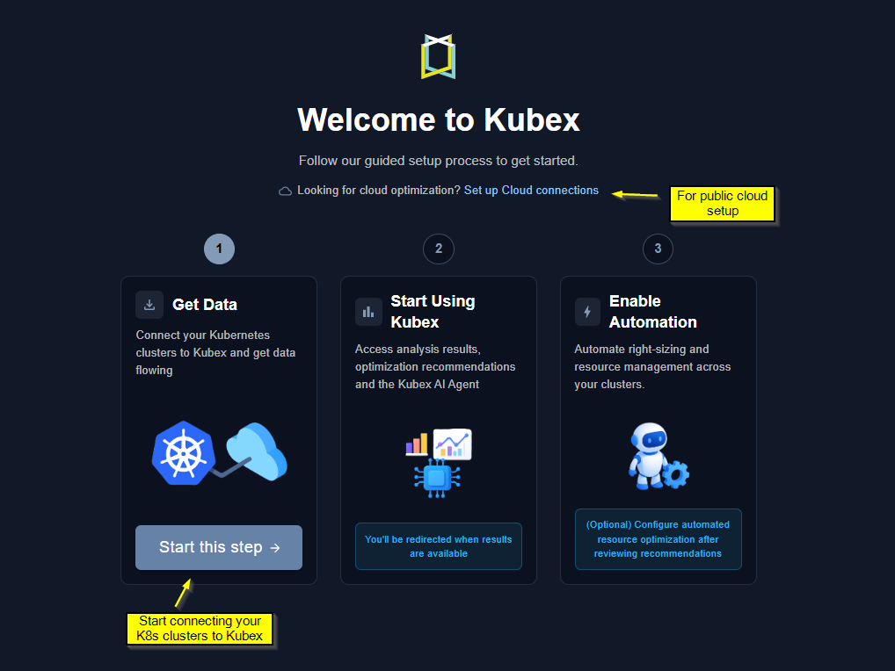
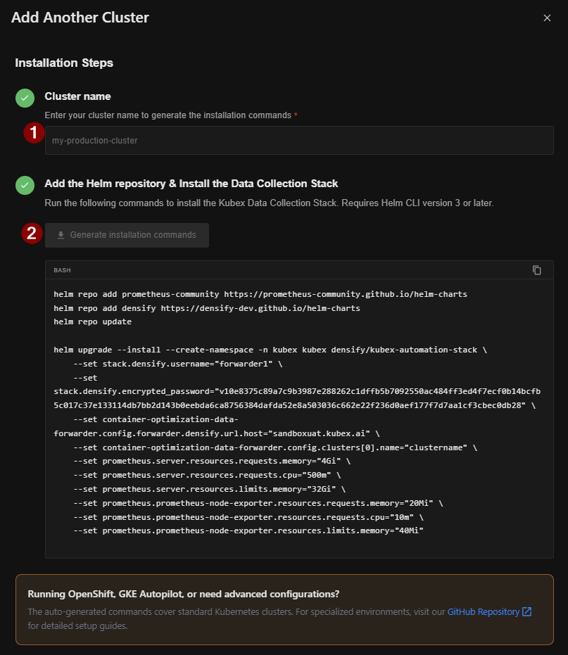
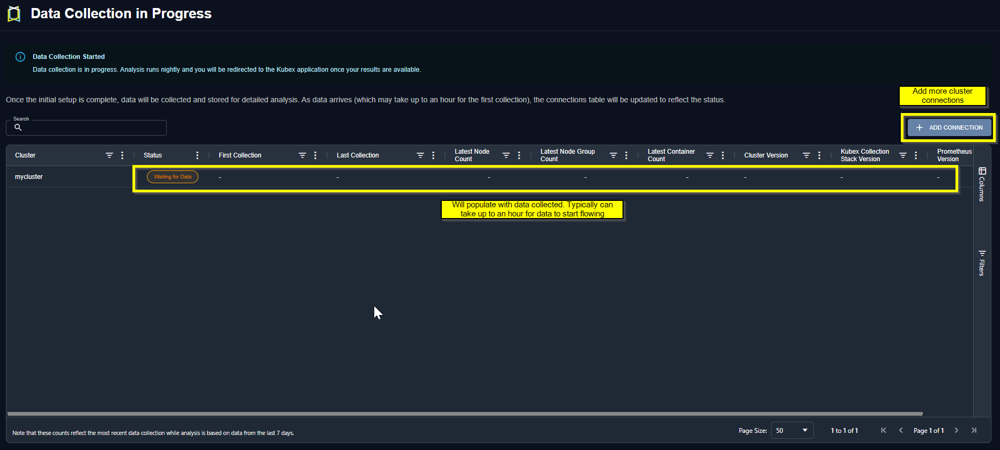

import { InlineImageWithText } from "/snippets/InlineImageWithText.mdx"

## Getting Started

When you first log into Kubex, you'll be presented with a getting started page that walks you through the process of connecting your Kubernetes clusters to Kubex.

<Frame caption="Figure: Data Collection Status Page">

</Frame>


<br/>

{/* BEGIN KUBEX AUTOMATION STACK INSTALLATION */}
## Installation

To deploy the Kubex Collection Stack, follow these steps below:

1. Determine your sizing file as described in [Sizing](https://github.com/densify-dev/helm-charts/blob/master/charts/kubex-automation-stack/README.md#sizing) and download it.

2. Download [values-edit.yaml](https://github.com/densify-dev/helm-charts/blob/master/charts/kubex-automation-stack/values-edit.yaml).

3. If deploying on OpenShift, use the OpenShift overlay file: [values-openshift.yaml](https://raw.githubusercontent.com/densify-dev/helm-charts/master/charts/kubex-automation-stack/values-openshift.yaml).

   User workload monitoring must be enabled in your OpenShift cluster to allow ephemeral storage and/or custom metrics data collection.

   Update the `cluster-monitoring-config` ConfigMap:

   ```shell
   kubectl -n openshift-monitoring edit configmap cluster-monitoring-config
   ```

   Ensure the config contains:

   ```yaml
   apiVersion: v1
   data:
     config.yaml: |
       enableUserWorkload: true
   kind: ConfigMap
   ```

   If the `cluster-monitoring-config` ConfigMap does not exist, create it with:

   ```shell
   kubectl -n openshift-monitoring create configmap cluster-monitoring-config --from-literal=config.yaml='enableUserWorkload: true'
   ```

4. Edit `values-edit.yaml` with the relevant mandatory parameters as described in [Configuration](https://github.com/densify-dev/helm-charts/blob/master/charts/kubex-automation-stack/README.md#configuration).

5. To add the helm repos, run:

```shell
helm repo add prometheus-community https://prometheus-community.github.io/helm-charts
helm repo add grafana https://grafana.github.io/helm-charts
helm repo add kubex https://densify-dev.github.io/helm-charts
helm repo update
```

If the automation engine is enabled, install or upgrade the required CRDs before installing or upgrading this stack:

```shell
helm upgrade --install kubex-crds kubex/kubex-crds \
  --namespace kubex \
  --create-namespace
```

The `kubex-crds` chart must be installed before the stack creates automation-engine resources.

6. If your cluster is not OpenShift, run this command:

```shell
helm install --create-namespace -n kubex -f values-edit.yaml -f <sizing file> kubex kubex/kubex-automation-stack
```

7. If your cluster is OpenShift, run this command:

```shell
helm install --create-namespace -n kubex -f values-edit.yaml -f <sizing file> -f https://raw.githubusercontent.com/densify-dev/helm-charts/master/charts/kubex-automation-stack/values-openshift.yaml kubex kubex/kubex-automation-stack
```

To override any OpenShift defaults, add another values file or `--set` options after the OpenShift overlay.
{/* END KUBEX AUTOMATION STACK INSTALLATION */}

<Frame caption="Figure: Data Collection Status Page">

</Frame>

<br/>

## Data Collection Status & Adding More Clusters

After deploying Kubex data collection, data will begin flowing within an hour. You can monitor the status of each cluster connection through the data collection status page, which is also accessible from the side panel. Kubex performs data analysis overnight, so data flowing in today will show analyzed results the following morning.

<Frame caption="Figure: Data Collection Status Page">

</Frame>

<br/>
Other configuration options including multi-cluster and observability platforms are also supported. See <a href="https://github.com/densify-dev/container-data-collection">Github</a> for other configuration options.

